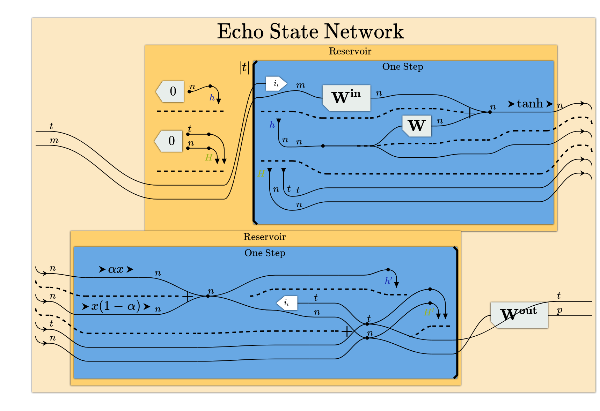

# reservoir

An echo state network written as a neural circuit diagram with [pyncd](https://github.com/starbaser/pyncd), drawn with [tsncd](https://github.com/starbaser/tsncd), and run
in PyTorch.

For [@verlainne](https://x.com/cafeantinomie).

## The model

An echo state network is a dynamical system driven by an input sequence. At step $t$ it receives an
input vector $u_t \in \mathbb{R}^m$, keeps a state vector $h_t \in \mathbb{R}^n$, and emits an
output vector $y_t \in \mathbb{R}^p$:

$$
h_t = (1 - \alpha)\, h_{t-1} + \alpha \tanh\left(W_{\mathrm{in}} u_t + W h_{t-1}\right), \qquad h_{-1} = 0
$$

$$
y_t = W_{\mathrm{out}} h_t
$$

The matrices $W_{\mathrm{in}} \in \mathbb{R}^{m \times n}$ and $W \in \mathbb{R}^{n \times n}$ are
drawn at random once and never changed. $W$ is scaled so that its spectral radius $\rho(W)$ is below
one, which makes the state forget its past at a geometric rate, and $\alpha \in (0, 1]$ is the leak
rate that sets how fast the state moves. The only matrix that is fit is
$W_{\mathrm{out}} \in \mathbb{R}^{n \times p}$, and it is fit by ridge regression: run the network
over a sequence, collect the states $H \in \mathbb{R}^{T \times n}$ (one row per step), and solve

$$
\left(H^{\top} H + \lambda I\right) W_{\mathrm{out}} = H^{\top} Y
$$

for the targets $Y \in \mathbb{R}^{T \times p}$. No gradient descent is involved. The network is a
random nonlinear feature map over time with a linear least-squares readout.

The neural circuit diagram is the same model drawn as wires and operations. A wire is an array axis,
labelled by its name, a box is an operation, and the repeated block is the loop over the steps.
pyncd compiles the step of that same expression to PyTorch, so the picture and the computation
cannot drift apart.

<picture>
  <source media="(prefers-color-scheme: dark)" srcset="docs/echo-state-network-dark.png">
  
</picture>

The figure is tsncd's drawing of the term, captured from the viewer that `just serve` runs. The
loop body is one step: `W_in` and `W` feed the tanh, the leak mixes the new value with the state
`h` carried around the loop, and each step writes its state into `H`, which `W_out` reads out.

## Requirements

- A GPU is optional. The run and the tests use every CUDA device Torch finds and the CPU otherwise.
- Network access on the first install, for the pyncd repository, the PyPI and PyTorch wheels and,
  without Nix, the tsncd repository and its npm dependencies.
- Either Nix with flakes, which provides every tool below, or `git`, `uv`, `just` and Node 24 with
  `npm`. Node is used once: pyncd's wheel build clones tsncd and builds the diagram page into the
  wheel, so no tsncd checkout is kept.

## Installing with Nix

```bash
git clone https://github.com/starbaser/reservoir.git && cd reservoir
nix develop                  # or: direnv allow
```

The shell's `python` is a Nix-built virtual environment with this package editable and pyncd built
from the commit `uv.lock` resolved from its `main` branch. pyncd's wheel carries the tsncd page,
which the flake takes from tsncd's own flake, so the shell needs no Node and no tsncd checkout.

## Installing without Nix

```bash
git clone https://github.com/starbaser/reservoir.git && cd reservoir
uv sync                      # Python 3.14, Torch, pyncd from its repository
```

`uv` installs Python 3.14 if the machine has none. Every `just` recipe runs through `uv run`.
Building pyncd's wheel clones the tsncd revision pyncd pins and runs `npm ci && npm run build`
inside the build, which is where Node 24 is needed.

## Running the network

```bash
just run                     # on the first CUDA device, or the CPU
just run --device cpu
just run --leak 0.3 --delay 5
```

The run prints two things. First, the SSA listing of the pyncd expression, which is the diagram
written as text, one operation per line, with the loop indented. Second, the delay task: pyncd
compiles the step and the readout of that expression to PyTorch, a reservoir of 100 units is run
over a random sequence of 1000 steps by calling the compiled step once per step, `W_out` is fit on
steps 100 to 700 to return the input from `delay` steps before, and the normalised error (root mean
square error divided by the standard deviation of the targets) is reported on steps 700 to 1000.
Zero is a perfect fit. At the defaults it is 0.0083.

## Using it from Python

```python
import torch
import agent_display
from reservoir import echo_state_network, reservoir_weights, run_in_torch

network = echo_state_network.echo_state_network()  # the pyncd expression
print(agent_display.listing(network))  # the SSA listing

step = run_in_torch.compile_step(leak=1.0, inputs=1, units=100)  # torch_compile
readout = run_in_torch.compile_readout(steps=300, units=100, outputs=1)

weights = reservoir_weights.random_reservoir(
    inputs=1,
    units=100,
    leak=1.0,
    spectral_radius=0.9,
    input_scale=0.5,
    seed=0,
    device=torch.device("cuda" if torch.cuda.is_available() else "cpu"),
)
sequence = torch.rand(1000, 1, dtype=torch.float64) - 0.5
states = run_in_torch.run_reservoir(step=step, weights=weights, input_sequence=sequence)
targets = torch.cat([torch.zeros(1, 1, dtype=torch.float64), sequence[:-1]]).to(
    states.device
)
readout_weights = reservoir_weights.fit_readout(
    states=states[100:700], targets=targets[100:700], ridge=1e-8
)
predicted = run_in_torch.apply_readout(
    readout=readout, states=states[700:], readout_weights=readout_weights
)
print(reservoir_weights.normalised_error(predicted=predicted, targets=targets[700:]))
```

`compile_step` and `compile_readout` follow the route of pyncd's own tutorial: every weight is moved
onto the tape, every size is bound to an integer, and `torch_compile` builds the module, which takes
the weights as operands. pyncd compiles a repeated block only for an integer repetition and has no
rule for a tape slot, so the loop over the steps is a Python loop that calls the compiled step.
`docs/echo-state-network.md` states what pyncd derives from the expression and what it does not.

## Drawing the diagram

tsncd draws the diagram, and pyncd's wheel carries tsncd's page. One command serves the page and
the relay the page connects to, on one port:

```bash
just serve                   # http://localhost:3333/
just draw                    # send the network to the relay; the open page draws it
just serve 8765              # another port; `just draw 8765` sends there
```

`just serve` runs pyncd's `pyncd-server`, and `just draw` sends the network through pyncd's own
`send_morphism`. The relay holds the last model it was sent, so a refreshed page draws it again. On
the page, the buttons switch between three forms of the diagram and two themes, and moving the
pointer over `W_out` opens a box with the readout's formula.

## Checks

```bash
just test        # the expression, the compiled step and readout on the CPU and every
                 # CUDA device, the ridge fit, and the run
just quality     # ruff format, ruff check, ty
```

## Reading further

- `docs/echo-state-network.md`, each line of the equations beside its spelling in pyncd.
- `skills/using-ncd/SKILL.md`, pyncd and tsncd as a whole: the construction syntax, the rules for
  reading a diagram, the listing, compilation and drawing.
- Vincent Abbott and Gioele Zardini, _Weaves, Wires, and Morphisms_, [arXiv:2604.07242](https://arxiv.org/abs/2604.07242), the method.
- [mit-zardini-lab/pyncd](https://github.com/mit-zardini-lab/pyncd) and [mit-zardini-lab/tsncd](https://github.com/mit-zardini-lab/tsncd), the upstream repositories. This project uses
  forks of both, from their `main` branches.
