# Neural circuit diagrams with PyNCD and tsncd

PyNCD writes a deep learning model as a morphism in a product category of arrays and
derives things from it: the SSA listing, a PyTorch module, a backward pass, quantisations,
caches. tsncd takes that term as JSON and draws the neural circuit diagram in a browser;
it does no algebra. PyNCD is canonical and tsncd mirrors its data structure class by
class.

Verified against [PyNCD](https://github.com/starbaser/pyncd) `0eae8e09d7ed53114ae86fc742b4919ee534c7dd`
and [tsncd](https://github.com/starbaser/tsncd) `b8649a6492c15244cf2b0be49e0acf2e2abb32d7`
(2026-10-31). The reservoir project pins PyNCD at `d056b47`, which adds the relay
address configuration, a `torch_compile` fix and the packaging on top of that revision,
and the links below point at it. PyNCD and tsncd are dependencies: adapt in the
consuming project rather than in them, and check the revision a project actually
consumes before relying on advice here.

## Route by task

| Task | Read |
|---|---|
| Build or change a model expression | [Tutorial starting points](#start-with-the-upstream-tutorials), then [model-rulings.md](reference/model-rulings.md) and [pyncd-api.md](reference/pyncd-api.md) |
| Compile or train | [Tutorial starting points](#start-with-the-upstream-tutorials), then [integrating-as-dependency.md](reference/integrating-as-dependency.md#training-a-model-that-holds-parameter-arrays), then [pyncd-api.md](reference/pyncd-api.md#compiling-to-pytorch) |
| A rewrite reaches its iteration limit | [Existing rewrite-limit settings](reference/pyncd-api.md#rewrite-limits) |
| Read, explain or debug a diagram or a listing | the Section 2 reproduction below, then [diagrams-and-tsncd.md](reference/diagrams-and-tsncd.md) |
| Draw a figure, open a page, capture an image | [diagrams-and-tsncd.md](reference/diagrams-and-tsncd.md) |
| Add PyNCD or tsncd to a project, package, pin, serve | [integrating-as-dependency.md](reference/integrating-as-dependency.md) |
| Explain the mathematics or justify a construction | [weaves-wires-morphisms.md](reference/weaves-wires-morphisms.md) |
| Start from a working model | [worked-examples.md](reference/worked-examples.md) |

## Start with the upstream tutorials

Read and run the relevant tutorial example before adding integration machinery. Check
its input/output signatures, numerical result and rendered diagram in the environment
the consuming project actually uses.

| Need | Primary source |
|---|---|
| Wires, products, held values and lifting | [BuildingAModel, sections 2–4](https://github.com/starbaser/pyncd/blob/d056b4755fad127e48063739126fc2f19192650b/notebooks/base_features/BuildingAModel.ipynb) |
| Ordinary boxes, shared values on tape, tape-aware boxes | [BuildingAModel, section 9](https://github.com/starbaser/pyncd/blob/d056b4755fad127e48063739126fc2f19192650b/notebooks/base_features/BuildingAModel.ipynb), code cells 36, 40, 42 and 44 (zero-based notebook cell indices) |
| Size binding and direct PyTorch compilation | [BuildingAModel, sections 10–11](https://github.com/starbaser/pyncd/blob/d056b4755fad127e48063739126fc2f19192650b/notebooks/base_features/BuildingAModel.ipynb) |
| Parameters, ordered tape operands and gradient comparisons | [check_gradients_in_torch.py](https://github.com/starbaser/pyncd/blob/d056b4755fad127e48063739126fc2f19192650b/notebooks/website/tutorial/check_gradients_in_torch.py), `compile_pass` and `forward_agrees_with` |
| Notebook construction helpers | [DeepSeek construction idioms](https://github.com/starbaser/pyncd/blob/d056b4755fad127e48063739126fc2f19192650b/notebooks/sota/DeepSeekV41Flash/construction_idioms.py) |

The [executable example](scripts/tutorial_model.py) combines direct wires, ordinary
boxes and two layers that read one published activation. It checks values and gradients
against PyTorch and calls `show_diagram` on the same authored expression. Its small
compilation adapter applies upstream expansion and tape passes; it is example code,
not an upstream compiler entry point. See [how to run it](reference/worked-examples.md#tutorial-based-executable-example).

Use wires for ordinary intermediate results. Use tape when a layer publishes a value
that later layers reuse, as the tutorial does. An ordinary component uses
`ops.BlockOperator`; a boxed component that actually reads or writes tape uses
`ParaBlockOperator`. Do not replace ordinary dataflow with tape or add a dummy carrier
just to make a chain compose. A diagram and an execution form must derive from one
model expression, not from separately maintained descriptions of the model.

## Mindset: a model is a morphism

- **Objects are arrays, and a wire is an axis.** An object is a flat product of arrays
  `cat.Array(datatype, shape)`; in a diagram every axis is one wire and the arrays of a
  tuple are separated by a dashed line. A rank-0 array is a wire with no axis.
- **A morphism is composed sequentially (`;`, drawn left to right) and in parallel
  (`⊗`, drawn stacked).** `Composed`, `ProductOfMorphisms`, `Rearrangement` (permute,
  copy, delete wires) and `Block` (group, loop) are the four constructions; everything
  else is a seed.
- **A seed is one broadcasted operation.** `Broadcasted(operator, input_weaves,
  output_weaves, reindexings)`. A weave marks each position of an array as `TILED`
  (broadcast over, the *degree*) or an axis the operator consumes (the *target*). The
  degree is one tuple shared by the whole seed; each input's reindexing says which degree
  positions that input reads and with what affine strides. One operator therefore
  expresses a transpose, a diagonal, a repeat or a convolution window.
- **Reindexings live in the axis category St**, whose morphisms are affine index maps
  (`StrideMorphism`), read against the data flow: output index to input index. A read
  outside an axis yields the universal unit, which is how causality and padding are
  stated without a mask operator.
- **Axes are identified by UID, never by name.** `cat.RawAxis.named('x')` twice is two
  axes. `@` identifies axes by position, pair by pair, and lifts the shorter side over
  surplus axes. Two letters in two templates become one axis only when a composition puts
  them at the same position.
- **Sizes are free symbols until one `NumericConfig` assigns them.** No integer literal
  in a construction. Assert that no free sizes remain after binding; this revision does
  not reliably reject incompatible literal extents or unknown configuration names.
- **Weights ride operators.** A `Linear` holds its weight; a `Linear` with no inputs is a
  parameter array; Para tapes carry what layers publish and read. The algebra is the
  Alg layer of the paper: two expressions may compute one function and differ as
  algorithms, which is the point of drawing them.
- **Read with the listing, draw for a person.** `agent_display.listing` is deterministic
  text; the browser diagram is for a human reader and for images.

## The construction syntax

```python
import construction_helpers  # noqa: F401 - installs @, * and >>; raises without it
import data_structure.Category as cat
import data_structure.Operators as ops
```

| Syntax | Reads as | Diagram |
|---|---|---|
| `f @ g` | sequential composition with positional axis alignment | `g` drawn to the right of `f` |
| `f * g` | parallel product; `array * f` carries the array as an identity | stacked, dashed line between |
| `x >> f` | broadcast `f` over axis `x` on every input and output; `x` leads every array | a wire passing over `f` |
| `(0, 0) @ f` | copy one wire into two before `f` | a wire splitting |
| `(1, 0)`, `()`, `(0, 1, 1)` | swap, delete, copy the second | crossing, ending, splitting |
| `cat.Rearrangement((1,), (A, H))` | the same with an explicit domain | |
| `ops.Einops.template('q h d, x h d -> h q x')` | contract the left-only letters; both-sides letters are degree; right-only letters repeat | cups for contraction, wires over for degree |
| `ops.Linear.template(('m',), ('h', 'd'), 'W^Q')` | a weight held inside the operator | bold chipped rectangle |
| `cat.ProdObject((array,)).identity()` | hold a wire (`hold`) | a plain wire |
| `lift.morphism_object_lift(f, cat.ProdObject((x,)))` | lift one operation alone (`over`) | |
| `cat.Block.template(body, title=..., fill_color=..., repetition=n)` | group; `n != 1` is a loop | backdrop, loop bracket |
| `ops.BlockOperator.template(block, 'Name')` | one bold box; body drawn once beside the figure | |
| `einops_simplification.einsum(((v, u), (u, c)), (v, c), R)` | a contraction over declared axes and index variables | |
| `ops.View.template(reindexing=(stride, id))` | an affine read | hexagon or pentagon on the wire |

Reading a listing: `%4 = Einops(%0[q, {d}], %1[x, {d}]) : R[q, x]` says the operation
consumes `d` of both operands (braces) and is broadcast over `q` and `x`.

Reading the picture (the conventions tsncd draws, all from the paper below): a wire over
a glyph is an axis the operation is broadcast over; a wire into a glyph is consumed; a
dashed line separates the arrays of a tuple; a tuple line ending is a multiplication and
a curved cup is a contraction; wires crossing transpose, merging diagonalise, ending
delete; a pointed pentagon is an index; a hexagon is a stride reindexing; a bold chipped
`L` is a learned linear map; a bold circle with a tick is RMSNorm; an expanding triangle
is softmax; an arrowed wire is an explicit datatype such as an integer index; a backdrop
is a block and a bracket with a count is a loop; `:=` separates an operator from its
definition.

## Workflow

1. Run the relevant tutorial and verify the source revision. Read the linked construction
   rules before changing a model's representation.
2. Declare axes and arrays. Write seeds with templates; compose with `@`, `*`, `>>`,
   rearrangements and explicit identities. Use declared-axis `einsum` where appropriate.
3. Box components according to their actual wire/tape interfaces. Assert both ends of
   each chain; a repeated block must have the same domain and codomain.
4. Inspect `agent_display.listing(term)`. Bind sizes with `NumericConfig` and assert that
   no unbound sizes remain.
5. Compile the sized expression with `ConstructedModule.construct` when its operations
   have numerical implementations. Expand ordinary boxes with their native `.expand()`;
   a `ParaWrap` exposes its explicit seeds with `.to_base()`. Resolve internal published
   values with `tie_tapes`. For learned parameter arrays, follow the tutorial's
   `grab_parameters`, grouping removal, `detape` and ordered-operand compilation route.
   The [integration reference](reference/integrating-as-dependency.md#training-a-model-that-holds-parameter-arrays)
   explains the order and revision limits.
6. Compare values and gradients with an independent numerical reference. Passing this
   comparison checks the computation; separately verify library integration and drawing.
7. Draw the authored expression through `notebook_diagrams.show_diagram`. Use its
   interactive HTML mode for a page, or its notebook/headless routes for figures. Inspect
   the actual rendered result, including component bodies and tape ports.

## Guardrails

- `@` may lift a rank mismatch or hold surplus wires instead of rejecting it. Explicit
  `cat.Composed` also does not validate adjoining signatures. Assert domain and codomain.
- Carry an array with `cat.ProdObject((array,)).identity()`. At this revision an identity
  written as `ops.Einops.template('a b -> a b')` loses its array shape.
- When a product mixes held wires and a lower-rank operation, pre-lift that operation
  with `lift.morphism_object_lift`; otherwise autoalignment may lift the held wires too.
- `Elementwise.template(name=...)` compiles as ReLU regardless of the name. State the
  formula with `Arithmetic.template(nm.x * nm.Sigmoid(nm.x))` for SiLU.
- Learned normalization gains and zero-input `Linear` parameter arrays require parameter
  extraction. Do not assume direct compilation trains every parameter a glyph suggests.
- `View` states affine reindexing, but the compiler at this revision handles rearranging
  views only. A numerical implementation may use the documented `operation_key` extension
  point in the consumer. Verify numerical values and gradients; inspect existing registry
  entries before replacing one because registration is process-wide.
- The compiler does not directly dispatch on `BlockOperator` or `ParaWrap` here. Use their
  native expansions. For tape-aware boxes, let `ParaBlockOperator.expand` expose ports;
  do not reconstruct those ports by hand. Nested wraps can exceed that expansion's
  support: reduce a failure to a small example before attributing it to the architecture.
- `detape` exposes top-level grabs and drops as trailing operands/results. It does not
  connect an internal publisher to its readers; `tie_tapes` does that. Do not assume a
  parameter grab inside an arbitrary repeated block is reachable by `detape`.
- Mathematical expressibility, compiler support and renderer support are separate
  questions. An unsupported compiler case does not invalidate a categorical expression.
- PyNCD already serializes its terms and tsncd already renders them. Use those APIs;
  do not maintain a second topology, serializer or renderer. A class with no tsncd mirror
  fails with `Term type not found in TermDirectory`; inspect the listing and report the
  unsupported class rather than patching the dependency in the consumer.
- Keep debug borders off. Pass `debugBorders=False` to lower-level rendering calls;
  `show_diagram` supplies it through its own settings path. Inspect a browser screenshot
  when visual correctness matters; a valid listing alone does not establish it.

## Reading Neural Circuit Diagrams

Section 2 of Vincent Abbott, *Neural Circuit Diagrams: Robust Diagrams for the
Communication, Implementation, and Analysis of Deep Learning Architectures* (TMLR,
December 2023; arXiv:2402.05424), reproduced verbatim. Figures are numbered locally as
S2.1 to S2.17 and the images are the paper's own figures, in
[assets/ncd-figures/](assets/ncd-figures/); open one with the Read tool to see it.
"(See cell n, Jupyter notebook.)" refers to the paper's companion notebook.

### 2.1 Commutative Diagrams

We aim to craft diagrams that precisely represent deep learning algorithms. While these
diagrams will eventually be generalized, we will initially concentrate on common models.
Specifically, we will explore models that successively process data of predictable types.
To facilitate understanding, we will introduce diagrams of gradually increasing
complexity. To begin, let's delve into an intuitive diagram, where symbols represent data
types, and arrows signify the functions connecting them.

Note, I use forward composition with "$;$", meaning $f:\text{str}\rightarrow\text{int}$
composes with $g:\text{int}\rightarrow\text{float}$ by $(f;g):\text{str}\rightarrow\text{float}$.

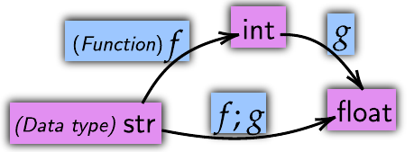
**Figure S2.1.** We have two functions: $f:\text{str}\rightarrow\text{int}$ and
$g:\text{int}\rightarrow\text{float}$. These functions can be composed into a single
function $(f;g):\text{str}\rightarrow\text{float}$. In commuting diagrams, we represent
data types, such as $\text{str}$, $\text{int}$, and $\text{float}$, with floating symbols,
while functions are denoted by arrows connecting them.

#### Tuples and Memory

Algorithms are rarely composed of operations on a single variable. Instead, their steps
involve operations on memory states composed of multiple variables. The data type of a
memory state is a tuple of the variables which compose it. So, a state containing an
$\text{int}$ and a $\text{str}$ would have a type $\text{int}\times\text{str}$.

Consider a single algorithmic step acting on a compound memory state $A\times B\times C$.
A function $f:B\times C\rightarrow D$ acting on this memory state would give an overall
step with shape $\text{Id}[A]\times f:A\times(B\times C)\rightarrow A\times D$. Note that
$\text{Id}[A]$ is the identity. We need to indicate $A$, even though $f$ does not act on
it, so that the initial and final memory states are properly shown. In Figure S2.2, I
diagram $f$ along another function $g:A\times D\rightarrow E$.

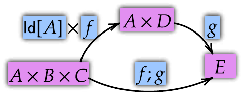
**Figure S2.2.** Here, I diagram two functions, $f:B\times C\rightarrow D$ and
$g:A\times D\rightarrow E$, acting together. To represent the full memory states, we are
required to amend $f$ into $\text{Id}[A]\times f:A\times(B\times C)\rightarrow A\times D$.
The composed function is $(\text{Id}[A]\times f);g:A\times(B\times C)\rightarrow E$.

### 2.2 String Diagrams

These commuting diagrams fall short, however. As algorithms scale, operations and memory
states get more complex. Usually, functions only act on some variables. However, it is not
clear how to these targeted functions. Compound data types and compound functions are
better suited by reorienting diagrams as in Figure S2.3. We will have horizontal wires
represent types, and symbols represent functions. Diagrams are forced to horizontally go
left to right.

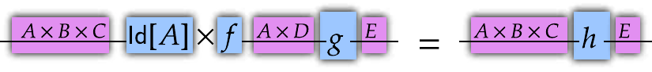
**Figure S2.3.** We reorient diagrams to go left to right. Wires represent data types, and
symbols represent functions. This expression defines $h$.

This reorientation allows us to represent compound types and functions easily. We can
diagram tupled types $A\times B$ as a wire for $A$ and a wire for $B$ vertically stacked,
but separated by a dashed line. For increased clarity, we can draw boxes around
functions. In Figure S2.4, we see a clear reexpression of Figure S2.3. Here, we have the
unchanged $A$ variable untouched by $f$, which acts only on $B\times C$.

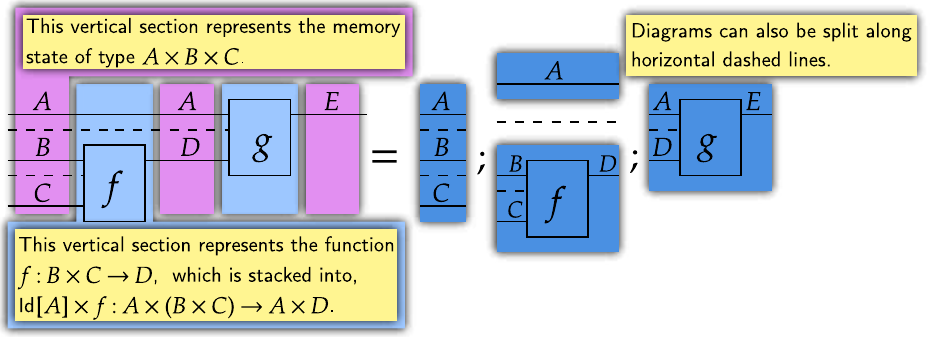
**Figure S2.4.** Tupled data types are diagrammed with wires separated by dashed lines.
This clearly shows when functions act on only some variables.

Every vertical section of a diagram represents something. Either, it shows which data type
is present in memory, or which function is applied at this step. Diagrams can always be
decomposed into vertical sections, each of which must compose with adjacent sections to
ensure algorithms are well-defined. Diagrams can also be split along dashed lines.
Diagrams are built from these vertically and horizontally composed sections, with wires
acting like jigsaw indents.

### 2.3 Tensors

We will specialize our diagrams for deep learning models whose memory states are tuples of
tensors. Tensors are numbers arranged along axes. So, a scalar $\mathbb{R}$ is a rank 0
tensor, a vector $\mathbb{R}^{3}$ is a rank 1 tensor, a table $\mathbb{R}^{4\times 3}$ is a
rank 2 tensor, and so on. If our diagram takes tensor data types, we get something like
Figure S2.5.

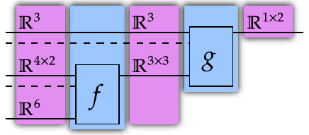
**Figure S2.5.** Similar to Figure S2.4, but with data types being tensors.

However, we benefit from diagramming the details of axes. Instead of diagramming a wire
labeled $\mathbb{R}^{a\times b}$, we diagram a wire labeled $a$ and a wire labeled $b$,
without a dashed line separating them. This lets us diagram Figure S2.5 into the clear
form of Figure S2.6.

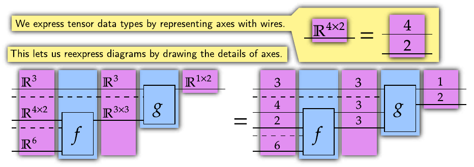
**Figure S2.6.** We can diagram types $\mathbb{R}^{a\times b}$ as two wires labeled $a$ and
$b$, without a dashed line separating them. (See cell 2, Jupyter notebook.)

#### Indexes

Values in tensors are accessed by indexes. A tensor $A\in\mathbb{R}^{4\times 3}$, for
example, has constituent values $A[i_{4},j_{3}]\in\mathbb{R}$, where $i_{4}\in\{0\dotsc 3\}$
and $j_{3}\in\{0\dotsc 2\}$. Indexes can also be used to access subtensors, so we have
expressions $A[i_{4},:]\in\mathbb{R}^{3}$. This subtensor extraction is therefore an
operation $\mathbb{R}^{4\times 3}\rightarrow\mathbb{R}^{3}$. We diagram it by having indexes
act on the relevant axis. Indexes are diagrammed with pointed pentagons, or kets
$\lvert\_\rangle$. This type of subtensor extraction is diagrammed according to Figure S2.7.

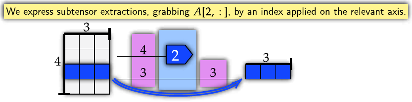
**Figure S2.7.** We diagram indexes with pointed pentagons labeled with the index being
extracted. (See cell 3, Jupyter notebook.)

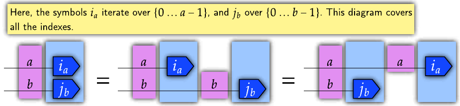
**Figure S2.8.** These subtensors are defined such that $A[i_{4},:][j_{3}]=A[i_{4},j_{3}]$.
This expression is the same in the reverse order. (See cell 4, Jupyter notebook.)

#### Broadcasting

Broadcasting is critical to understanding deep learning models. It lifts an operation to
act in parallel over additional axes. Here, we show an operation
$G:\mathbb{R}^{3}\rightarrow\mathbb{R}^{2}$ lifted to an operation
$G':\mathbb{R}^{4\times 3}\rightarrow\mathbb{R}^{4\times 2}$. We diagram this broadcasting
by having the $4$-length wire pass over $G$, adding a $4$-length axis to its input and
output shapes. Formally, we define $G'(x)[i_{4},:]=G(x[i_{4},:])$. This is shown in Figure
S2.9.

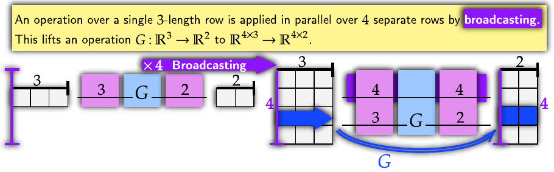
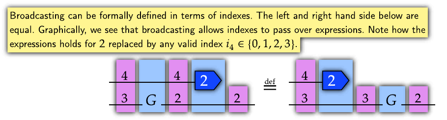
**Figure S2.9.** An operation is lifted over a $4$-length axis by broadcasting. This applies
$G$ over corresponding subtensors. Broadcasting can be formally defined by equating
indexes before and after an operation. (See cell 5, Jupyter notebook.)

Inner broadcasting acts within tuple segments. A $\mathbb{R}^{4\times 3}\times\mathbb{R}^{4}$
collection of data can be reduced to $\mathbb{R}^{3}\times\mathbb{R}^{4}$ in $4$ different
ways. Therefore, there are $4$ ways of applying an operation
$H:\mathbb{R}^{3}\times\mathbb{R}^{4}\rightarrow\mathbb{R}^{2}$ to it. This gives a function
lifted by "inner broadcasting", which has a shape
$\mathbb{R}^{4\times 3}\times\mathbb{R}^{4}\rightarrow\mathbb{R}^{4\times 2}$. We diagram
this by drawing a wire from the source tuple segment over the function, as shown in
Figure S2.10. This adds an axis of equal length to the target tuple segment and to the
output, reflecting the shape of the lifted operation.

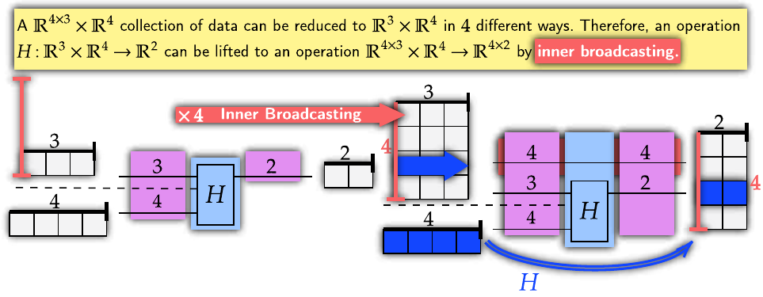
**Figure S2.10.** Lifting an operation within a tuple segment gives inner broadcasting. We
diagram it by having a wire from the target tuple segment over the function, reflecting
the shape of the lifted function. (See cell 6, Jupyter notebook.)

Broadcasting naturally represents element-wise operations. A function on values
$f:\mathbb{R}^{1}\rightarrow\mathbb{R}^{1}$, when broadcast, gives an operation
$\mathbb{R}^{1\times a}\rightarrow\mathbb{R}^{1\times a}$. One length axes do not change
the shape of data, and can be freely amended or removed from pre-existing shapes by
arrows. This means we diagram element-wise functions by drawing incoming and outgoing
arrows, which represent the amendment and removal of a $1$-length axis. This is shown in
Figure S2.11.

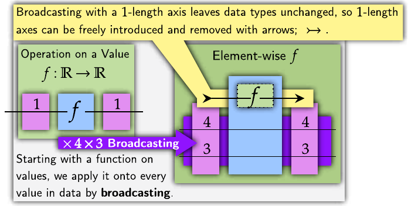
**Figure S2.11.** Element-wise operations can be naturally shown with broadcasting. (See
cell 7, Jupyter notebook.)

### 2.4 Linearity

Linear functions are an important class of operations for deep learning. Linear functions
can be highly parallelized, especially with GPUs. Previous works have shown how
graphically modeling linear functions, and reimplementing algorithms can improve
performance (Xu et al., 2023). Linear functions have immense regularity. Standard monoidal
string diagrams rely on these properties to provide elegant graphical languages for
various fields (Baez and Stay, 2010).

Linear functions are required to obey additivity and homogeneity, as shown in Figure
S2.12. These operations are closed under composition, so applying linear maps onto each
other gives another linear map. Importantly to us, they are natural with respect to
broadcasting. This means for any two linear functions $f$ and $g$, the equality in Figure
S2.13 holds. This means they can be simultaneously broadcast. This lets a series of linear
functions be efficiently parallelized and flexibly rearranged.

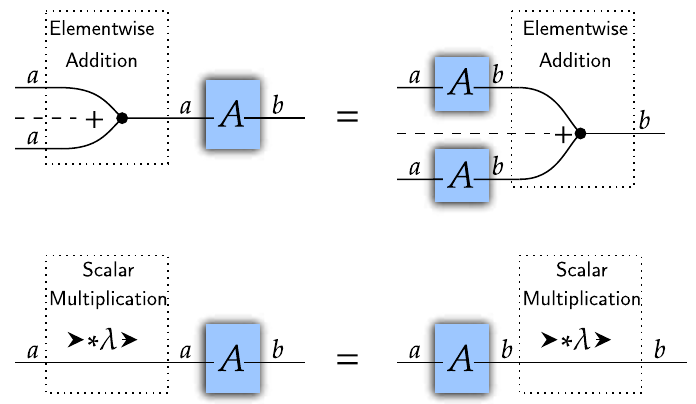
**Figure S2.12.** A subset of functions between $\mathbb{R}^{a}$ to $\mathbb{R}^{b}$ are
linear, obeying additivity and homogeneity. This class of functions are closed under
composition and has many important composition properties.

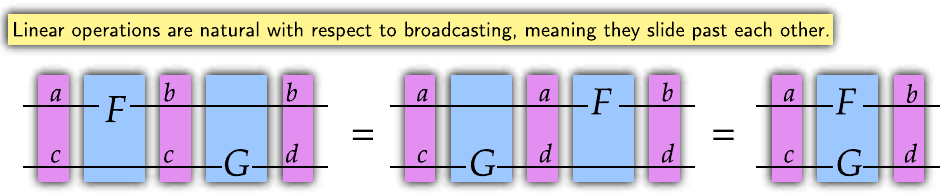
**Figure S2.13.** Linear functions are natural with respect to each other and
broadcasting. This means the above equality holds, letting expressions be flexibly
rearranged.

However, a pure monoidal string diagram has difficulty representing non-linear operations,
a noted issue (Chiang et al., 2023). Neural circuit diagrams have Cartesian products and
broadcasting, which are not generally analogous to how monoidal string diagrams combine
linear functions. If we know functions are linear, we can use diagrams to efficiently
reason about algorithms. By focusing on linear functions, we can take advantage of their
parallelization properties.

#### Multilinearity

There is an important distinction between linear and multilinear operations. Inner
products, for example, are multilinear. The inner product
$u(\mathbf{x},\mathbf{y})=\mathbf{x}\cdot\mathbf{y}=\Sigma_{i}\ x[i]\cdot y[i]$ is linear with
respect to each input. So, $u(\mathbf{x}+\mathbf{z},\mathbf{y})=u(\mathbf{x},\mathbf{y})+u(\mathbf{z},\mathbf{y})$,
and similarly for the second input. However, it is not linear with respect to element-wise
addition over its entire input and output, as
$u(\mathbf{x}_{1}+\mathbf{x}_{2},\mathbf{y}_{1}+\mathbf{y}_{2})\neq u(\mathbf{x}_{1},\mathbf{y}_{1})+u(\mathbf{x}_{2},\mathbf{y}_{2})$.
Compare this to copying $\Delta$, which we can show is linear.

$$
\begin{aligned}
\Delta:\mathbb{R}^{a}\rightarrow\mathbb{R}^{a\times a} &\text{ and }\mathbf{x},\mathbf{y}\in\mathbb{R}^{a},\ \lambda\in\mathbb{R}\\
\Delta(\mathbf{x}) &:= (\mathbf{x},\mathbf{x})\\
\Delta(\mathbf{x}+\mathbf{y}) &= (\mathbf{x}+\mathbf{y},\mathbf{x}+\mathbf{y})=(\mathbf{x},\mathbf{x})+(\mathbf{y}+\mathbf{y})\\
 &= \Delta(\mathbf{x})+\Delta(\mathbf{y})\\
\Delta(\lambda\cdot\mathbf{x}) &= (\lambda\cdot\mathbf{x},\lambda\cdot\mathbf{x})=\lambda\cdot(\mathbf{x},\mathbf{x})\\
 &= \lambda\cdot\Delta(\mathbf{x})
\end{aligned}
$$

To simultaneously broadcast multilinear functions, we note that every multilinear
operation equals an outer product followed by a linear function. The outer product is the
ur-multilinear operation, taking a tuple input and returning a tensor, which takes the
product over one element from each tuple segment. It is given by
$\otimes:\mathbb{R}^{a}\times\mathbb{R}^{b}\rightarrow\mathbb{R}^{a\times b}$. All
tuple-multilinear functions $M:\mathbb{R}^{a}\times\mathbb{R}^{b}\rightarrow\mathbb{R}^{c}$
have an associated tensor-linear form $M_{\lambda}:\mathbb{R}^{a\times b}\rightarrow\mathbb{R}^{c}$
such that $\otimes;M_{\lambda}=M$. We diagram the outer product by simply having a tuple
line ending, which will often occur before a host of linear operations are simultaneously
applied.

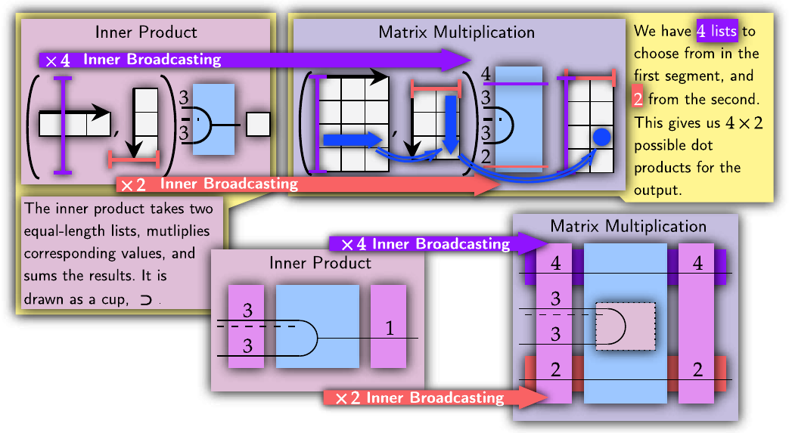
**Figure S2.14.** An in-depth example of matrix multiplication, a key multilinear inner
broadcast operation. Inner products are defined on vectors
$\mathbb{R}^n\times\mathbb{R}^n\rightarrow\mathbb{R}^1$. Then, we inner broadcast them to
act over matrices. The new $\mathbb{R}^{p\times n}\times\mathbb{R}^{n\times q}\rightarrow\mathbb{R}^{p\times q}$
operation is matrix multiplication. Therefore, we see that matrix multiplication is an
instance of an inner broadcast operation.

#### Implementing Linearity and Common Operations

Key linear and multilinear operations can be implemented by the einops package
(Rogozhnikov, *Einops*), leading to elegant implementations of algorithms. Some key linear
operations are **inner products**, which sum over an axis, **transposing**, which swaps
axes, **views**, which rearranges axes, and **diagonalization**, which makes axes take the
same index.

With neural circuit diagrams, we can clearly show these operations. We show inner products
with cups, transposing by crossing wires, views by solid lines consuming and producing
their respective shapes, and diagonalization by wires merging. As these operations are
linear, they can be simultaneously applied. The interaction of wires shows how incoming
axes coordinate to produce outgoing axes. The einops package symbolically implements these
operations by having incoming and outgoing axes correspond to symbols.

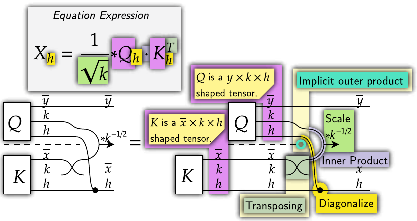
**Figure S2.15.** We can diagram a portion of multi-head attention, a sophisticated
algorithm, with clarity using neural circuit diagrams.

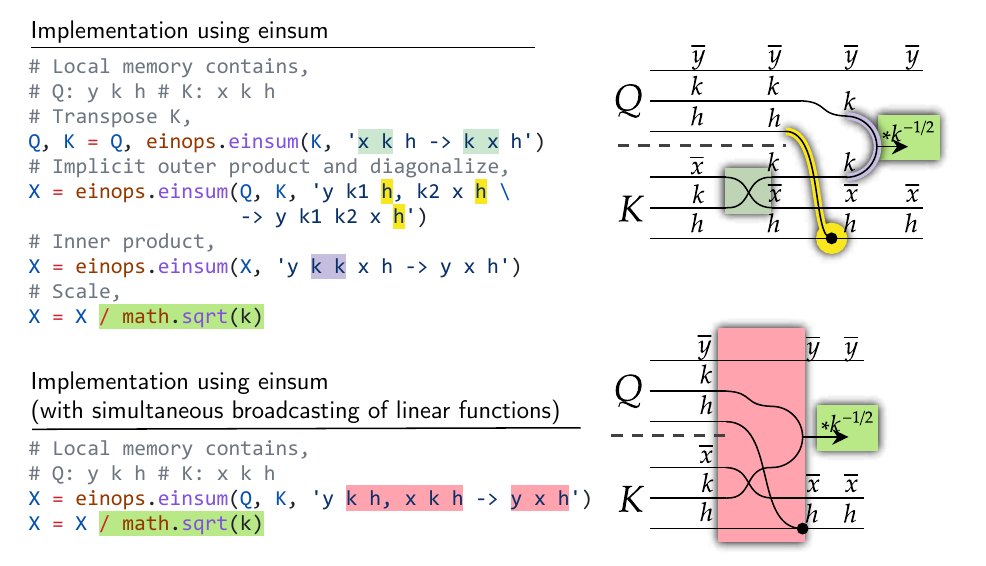
**Figure S2.16.** This section of multi-head attention can be implemented using the einsum
operation. Note the close relationship between diagrams and implementation and how
diagrams reflect the memory states and operations of algorithms. (See cell 8, Jupyter
notebook.)

An example that combines many of these operations is a section of multi-head attention
shown in Figure S2.15. It employs an outer product, a transpose, a diagonalization, an
inner product, and an element-wise operation. The input to this algorithm is a tuple of
tensors. Axes with an overline are a width, representing the amount of rather than detail
per thing. Though a complex expression, we can break this figure up as in Figure S2.6 and
implement the interaction of wires using einops, shown in Figure S2.16.

#### Linear Algebra

All linear functions $f:\mathbb{R}^{a}\rightarrow\mathbb{R}^{b}$ have an associated
$\mathbb{R}^{a\times b}$ tensor that uniquely identifies them. This hints at the ability to
transpose this associated tensor to get a new linear function,
$f^{T}:\mathbb{R}^{b}\rightarrow\mathbb{R}^{a}$. To extract these associated transposes, we
use the unit. The **unit** for a shape $a$, given by
$\eta:\mathbb{R}^{1}\rightarrow\mathbb{R}^{a\times a}$, is a linear map which returns $r$
times the $\mathbb{R}^{a\times a}$ identity matrix, for $r\in\mathbb{R}$.

Note that the associated transpose, which sends a linear function
$f:\mathbb{R}^n\rightarrow\mathbb{R}^m$ to $f^T:\mathbb{R}^m\rightarrow\mathbb{R}^n$ by
transposing the associated $\mathbb{R}^{n\times m}$ tensor, is different to a transpose
operation which sends $\mathbb{R}^{n\times m}$ to $\mathbb{R}^{m\times n}$. Associated
transposes are used for mathematical rearrangement and are not usually directly
implemented in code, though I provide code examples in cell 9 of the Jupyter notebook.

The unit and the inner product can be arranged to give the identity map
$\mathbb{R}^{a}\rightarrow\mathbb{R}^{a}$, as in Figure S2.17. This identity map can be
freely introduced, split into a unit and the identity matrix, and then used to rearrange
operations. For example, this allows us to convert the linear map
$F:\mathbb{R}^{a}\rightarrow\mathbb{R}^{b\times c}$ into
$F^{T}:\mathbb{R}^{b\times a}\rightarrow\mathbb{R}^{c}$. These associated tensors and
transposes can be used to better understand convolution (the paper's Section 3.3) and
backpropagation (the paper's Section 3.6).

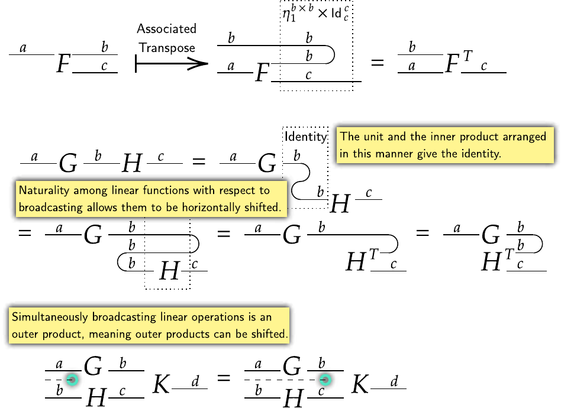
**Figure S2.17.** Linear operations have a flexible algebra. Simultaneous operations may
increase efficiency (Xu et al., 2023). As the height of diagrams is related to the amount
of data stored in independent segments, it gives a rough idea of memory usage. This is
further explored in the paper's Section 3.6. (See cell 9, Jupyter notebook.)

These rearrangements can transpose specific axes. A linear operation
$\mathbb{R}^{a\times b}\rightarrow\mathbb{R}^c$ has an associated
$\mathbb{R}^{a\times b\times c}$ tensor. This tensor can be associated with various linear
operations, such as $\mathbb{R}^{b\times a}\rightarrow\mathbb{R}^c$. These different forms
are often of interest to us, as they can efficiently implement the reverse of operations
(see the paper's convolution and differentiation figures). To extract these
rearrangements, we can selectively apply units and the inner product to reorient the
direction of wires for linear operations.


## Reference files

- [reference/pyncd-api.md](reference/pyncd-api.md): axes, operators and templates, the
  overloads, views, `einsum`, blocks, tapes, the listing, `NumericConfig`, compilation.
- [reference/model-rulings.md](reference/model-rulings.md): the 40 rules in short, the
  composition traps, weights, sizes, blocks, operator choices, reversed rulings.
- [reference/diagrams-and-tsncd.md](reference/diagrams-and-tsncd.md): the five rendering
  routes, display settings, the three figure forms, the wire protocol, the mirroring rule,
  adding a glyph, troubleshooting.
- [reference/integrating-as-dependency.md](reference/integrating-as-dependency.md): the pins,
  the Nix and plain-uv routes, the tsncd bundle and
  `TSNCD_DIST`, the relay, training parameter arrays through the tape, caveats, checklist.
- [reference/weaves-wires-morphisms.md](reference/weaves-wires-morphisms.md): the theory
  from the 2026 paper, with its definitions and its code listings mapped to PyNCD classes.
- [reference/worked-examples.md](reference/worked-examples.md): attention, a transformer,
  convolution, declared-axis contractions, compile checks, graph and cellular models, a
  render module.
